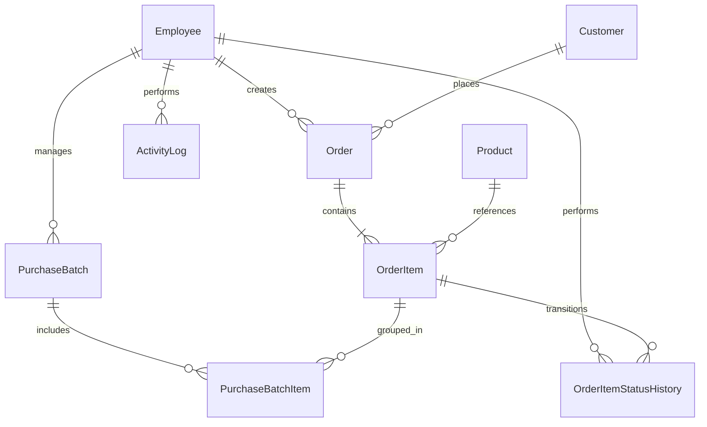

# Database Schema Specification

## 1. Relational Entity Diagram

## 2. Core Entities

### Employee
- `id` (UUID, PK)
- `fullName` (VARCHAR 100)
- `username` (VARCHAR 50, UNIQUE)
- `passwordHash` (TEXT)
- `pinHash` (TEXT, for action confirmation)
- `role` (ENUM: `ADMIN`, `EMPLOYEE`, `PURCHASING_MANAGER`)
- `isActive` (BOOLEAN, default true)
- `createdAt`, `updatedAt` (TIMESTAMPTZ)

### Customer
- `id` (UUID, PK)
- `phone` (VARCHAR 20, INDEXED)
- `customerCode` (VARCHAR 50, NULLABLE)
- `name` (VARCHAR 100, NULLABLE)
- `createdAt`, `updatedAt` (TIMESTAMPTZ)

### Product
- `id` (UUID, PK)
- `name` (VARCHAR 150, INDEXED)
- `strength` (VARCHAR 50, NULLABLE)
- `dosageForm` (VARCHAR 50)
- `barcode` (VARCHAR 50, NULLABLE)
- `createdAt`, `updatedAt` (TIMESTAMPTZ)

### Order
- `id` (UUID, PK)
- `requestNumber` (VARCHAR 30, UNIQUE, e.g. `REQ-000001`)
- `customerId` (UUID, FK -> Customer)
- `createdById` (UUID, FK -> Employee)
- `overallStatus` (ENUM: `OPEN`, `IN_PROGRESS`, `COMPLETED`, `CANCELLED`)
- `notes` (TEXT, NULLABLE)
- `createdAt`, `updatedAt` (TIMESTAMPTZ)

### OrderItem
- `id` (UUID, PK)
- `orderId` (UUID, FK -> Order)
- `productId` (UUID, FK -> Product)
- `productNameCustom` (VARCHAR 150)
- `strength` (VARCHAR 50, NULLABLE)
- `dosageForm` (VARCHAR 50)
- `requestedQuantity` (INTEGER)
- `receivedQuantity` (INTEGER, default 0)
- `priority` (ENUM: `NORMAL`, `URGENT`, `EMERGENCY`)
- `status` (ENUM: `NEW`, `REVIEWED`, `ADDED_TO_PURCHASE`, `ORDERED`, `PARTIALLY_RECEIVED`, `RECEIVED`, `CUSTOMER_NOTIFIED`, `DELIVERED`, `CANCELLED`)
- `notes` (TEXT, NULLABLE)
- `createdAt`, `updatedAt` (TIMESTAMPTZ)

### PurchaseBatch
- `id` (UUID, PK)
- `batchNumber` (VARCHAR 40, UNIQUE, e.g. `PB-202611-001`)
- `createdById` (UUID, FK -> Employee)
- `status` (ENUM: `DRAFT`, `ORDERED`, `PARTIALLY_RECEIVED`, `COMPLETED`, `CANCELLED`)
- `notes` (TEXT, NULLABLE)
- `supplierName` (VARCHAR 100, NULLABLE)
- `orderedAt` (TIMESTAMPTZ, NULLABLE)
- `createdAt`, `updatedAt` (TIMESTAMPTZ)

### PurchaseBatchItem
- `id` (UUID, PK)
- `batchId` (UUID, FK -> PurchaseBatch)
- `orderItemId` (UUID, FK -> OrderItem)
- `orderedQuantity` (INTEGER)
- `receivedQuantity` (INTEGER, default 0)
- `unitCost` (DECIMAL, NULLABLE)
- `createdAt`, `updatedAt` (TIMESTAMPTZ)

### OrderItemStatusHistory
- `id` (UUID, PK)
- `orderItemId` (UUID, FK -> OrderItem)
- `fromStatus` (VARCHAR 30)
- `toStatus` (VARCHAR 30)
- `authenticatedUserId` (UUID, FK -> Employee)
- `performerEmployeeId` (UUID, FK -> Employee)
- `notes` (TEXT, NULLABLE)
- `createdAt` (TIMESTAMPTZ)

### ActivityLog (Append-Only Audit)
- `id` (UUID, PK)
- `action` (VARCHAR 50)
- `entityType` (VARCHAR 50)
- `entityId` (VARCHAR 100)
- `previousState` (JSONB, NULLABLE)
- `newState` (JSONB, NULLABLE)
- `authenticatedUserId` (UUID, FK -> Employee)
- `performerEmployeeId` (UUID, FK -> Employee)
- `notes` (TEXT, NULLABLE)
- `createdAt` (TIMESTAMPTZ)
